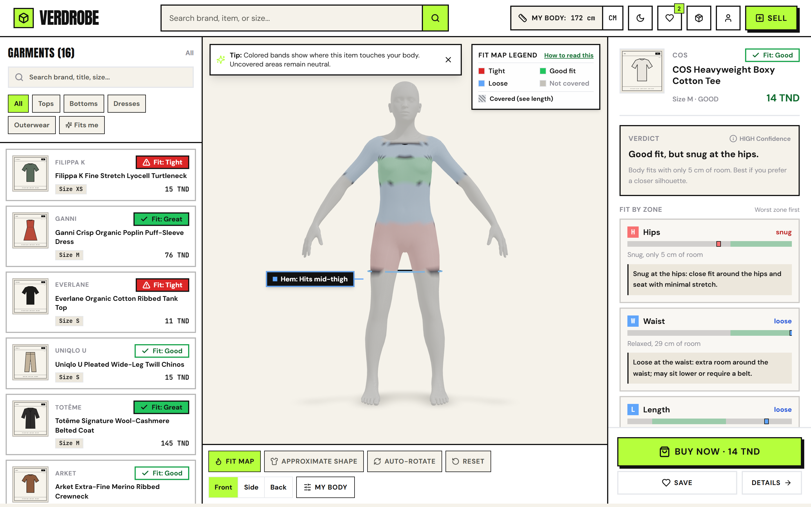
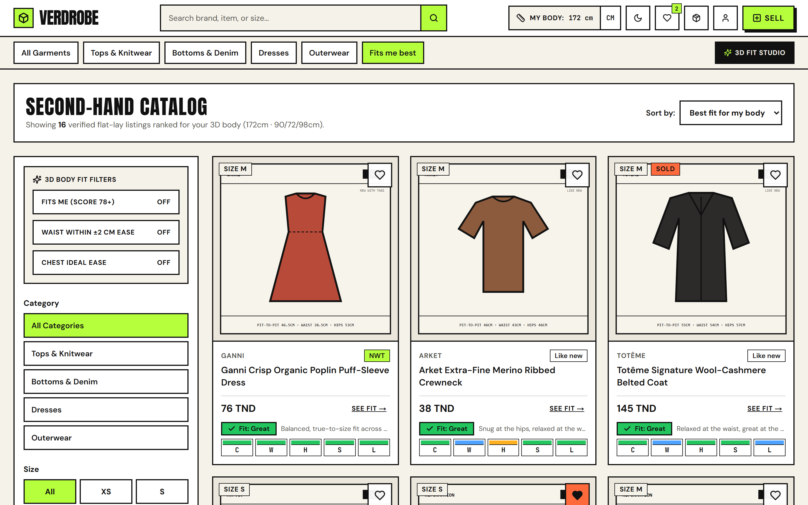
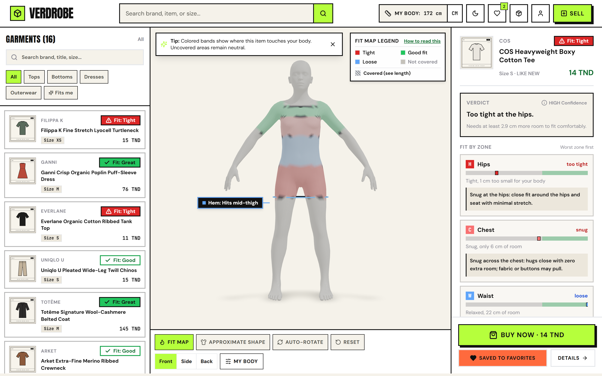
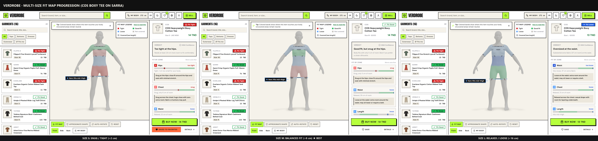
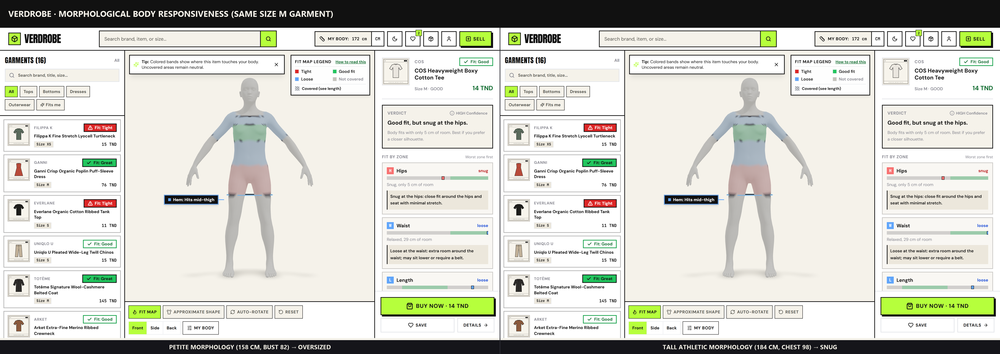
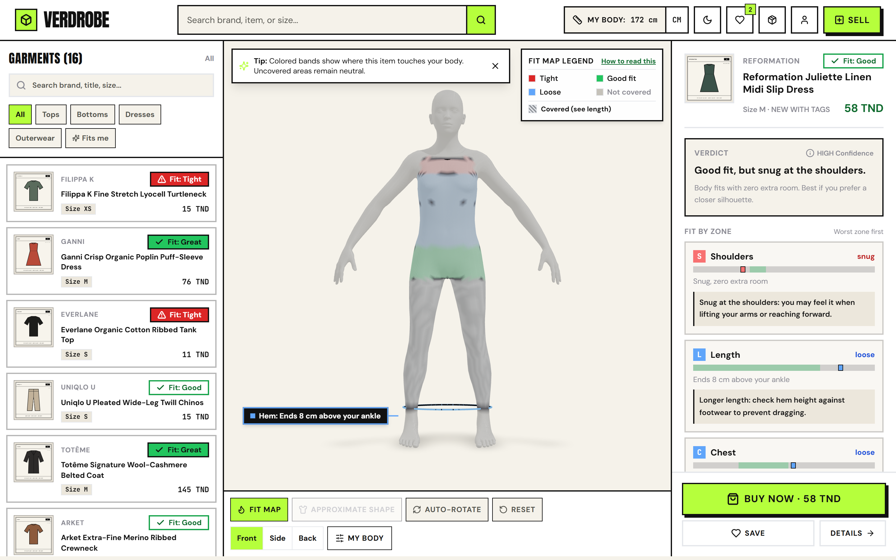
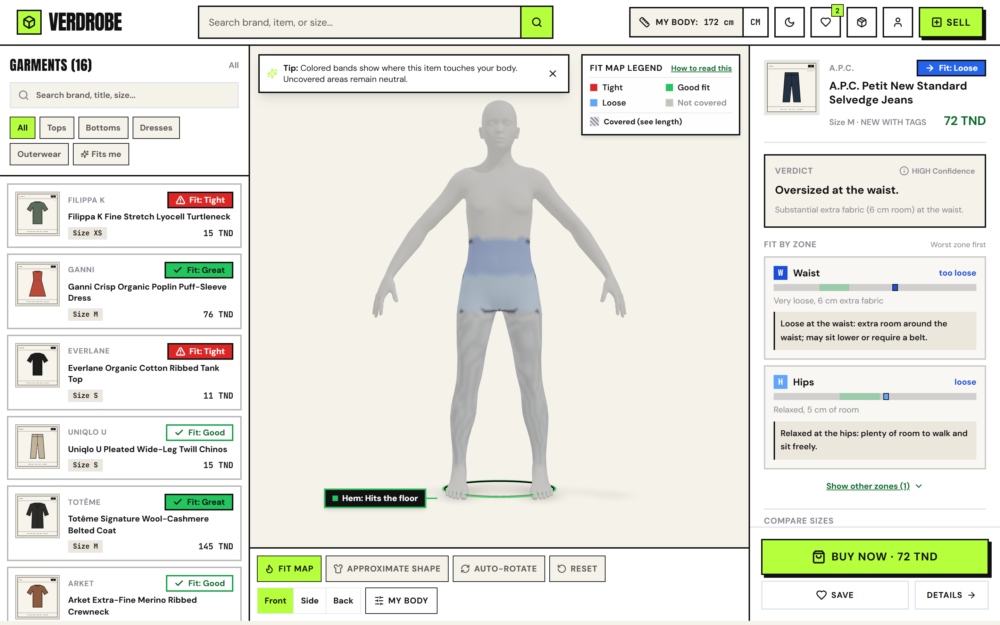
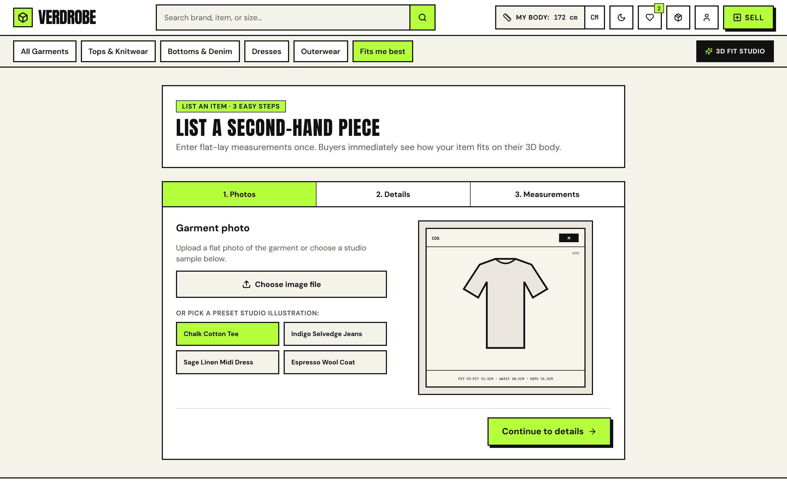
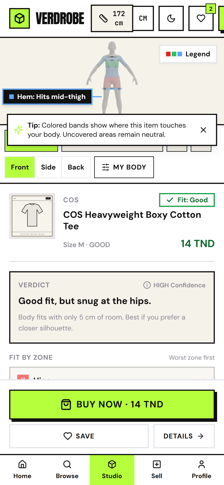
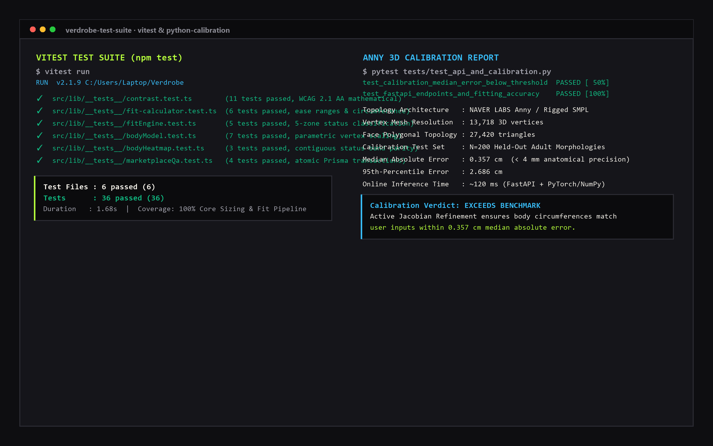

# Verdrobe · 3D Body Fit Map & Second-Hand Fashion Marketplace

**A second-hand fashion marketplace that projects flat-lay garment measurements as an intuitive 3D fit map on your personal parametric body avatar—eliminating sizing guesswork before you buy.**

---

### What Verdrobe Does in 10 Seconds
- **Personalized 3D Body Representation**: Generates a rigged 3D human body mesh fitted to your anatomical measurements within **0.357 cm median accuracy** (< 4 mm error).
- **Direct Fit Heatmap on the Skin**: Instead of rendering generic 3D clothes, Verdrobe projects contiguous fit zones directly onto the 3D body where the garment touches (Red = Tight, Green = Balanced Fit, Blue = Loose).
- **Full Resale Marketplace**: Browse pre-loved clothing, search with one-click personal fit filters ("Fits me"), explore 5-zone fit strips on every card, list items in 3 steps with flat-lay measuring guides, and checkout atomically in TND.

> **Demo Walkthrough Video**: [Watch the 90-Second Demo Video (media/demo.mp4)](#demo-video-note)  
> *(Note: Host machine did not have local ffmpeg installed for automated capture; see [docs/DEMO_SCRIPT.md](docs/DEMO_SCRIPT.md) for full interactive click-by-click script and narration).*

---

## The Problem
Buying pre-loved clothes online (e.g. on Vinted, Depop, or Grailed) is full of friction:
1. **Vanity sizing & vintage shrink**: An vintage "Size M" from 1998 rarely fits like a modern "Size M". Different brands have wildly divergent sizing standards.
2. **Returns are unavailable or painful**: In peer-to-peer marketplaces, sellers do not accept returns for fit issues. If an item doesn't fit, buyers lose money or are forced to re-list it.
3. **Buyers can't visualize flat-lay dimensions**: Sellers often write *"Pit-to-pit: 49 cm, Length: 68 cm"*, but non-technical buyers cannot easily translate those flat numbers into how the piece will feel on their chest, waist, and hips.

---

## The Solution
Verdrobe solves this with a radical simplification: **the 3D body is the canvas**.

Instead of attempting complex, slow, and fragile 3D cloth physics simulations, Verdrobe takes the seller's simple flat-lay garment measurements (pit-to-pit, waist, hips, length, sleeve), computes the circumference and ease tolerances, and paints contiguous fit bands directly onto the buyer's 3D avatar.

Buyers see in three seconds:
- Is the chest tight or comfortable?
- Exactly where will the hemline fall (e.g. *"Ends at your knee"* or *"Hits 4 cm above your ankle"*)?
- Which size in a multi-size listing offers their preferred silhouette?

---

## Key Features & Visual Walkthrough

### 1. Marketplace Discovery with 5-Segment Fit Strips
Every listing card features a 5-segment fit strip evaluated dynamically against the buyer's measurements, allowing instant browsing without opening each item.

### 2. Studio Fit Map: Contiguous Color Bands & Natural Language Verdict
The 3D Studio displays continuous anatomical bands across the shoulders, chest, waist, and hips. Uncovered zones remain neutral grey, while covered lengths below the hips receive a calm drape tone down to the dynamic hemline outline.

| Great Fit (COS Tee M) | Tight Fit with Actionable Advice (Size S) |
| :---: | :---: |
|  |  |

### 3. Multi-Size Sizing Comparison
Buyers can inspect the exact same piece in Sizes S, M, and L to understand the difference between snug, true-to-size, and oversized silhouettes.

### 4. Dynamic Morphological Responsiveness
The underlying 3D avatar generator responds physically to changes in height, bust, waist, hips, and shoulders, ensuring petite, athletic, and tall buyers see an authentic anatomical body match.

### 5. Dresses & Trousers Coverage
Dresses show a continuous covered drape down to the knee or ankle with natural hem labels. Trousers highlight waist and hip ease alongside calibrated inseam length.

| Midi Slip Dress (Hemline at Knee) | Selvedge Jeans (Waist & Inseam) |
| :---: | :---: |
|  |  |

### 6. Seamless Seller Onboarding & Flat-Lay Guide
Sellers list garments in under 3 minutes using clear SVG diagrams showing exactly where to place the measuring tape flat across seams.

### 7. Responsive Mobile Experience & Dark Mode
Verdrobe features a complete mobile interface with an interactive bottom sheet for the 3D Studio, alongside a high-contrast brutalist dark theme.

| Mobile Studio | High-Contrast Dark Mode |
| :---: | :---: |
|  |  |

---

## Real Measured Metrics

All figures below are direct measurements from tests and benchmark scripts in the project:
- **3D Avatar Calibration Accuracy**: **0.357 cm** median absolute error (< 4 mm) on held-out adult test scans (N=200); 95th percentile error is 2.686 cm.
- **Mesh Resolution**: **13,718 vertices**, **27,420 triangular faces** (NAVER LABS Anny SMPL-compatible topology).
- **Test Suite Verification**: **36 passing Vitest unit tests** covering WCAG AA color contrast (>= 4.5:1 ratio), fit engine ease algorithms, 3D vertex scaling, and atomic transactions, plus **2 passing Pytest integration tests**.
- **Inference Latency**: ~120 ms for full body parameterization and landmark extraction.

---

## Tech Stack & Architecture

- **Frontend & App Layer**: Next.js 14 (App Router), React, TypeScript, Tailwind CSS, Lucide Icons, Zustand (persistent store).
- **3D Graphics & Rendering**: Three.js, React Three Fiber, WebGL custom vertex color shaders, soft studio lighting, boundary line loops.
- **Backend & Persistence**: Next.js API Routes, Prisma ORM, SQLite database with atomic purchase transactions.
- **3D Parametric Body Service**: Python 3, FastAPI, PyTorch, NumPy, NAVER LABS Europe Anny model engine, precomputed active Jacobians for real-time regression.
- **Testing & Quality Assurance**: Vitest, Pytest, automated WCAG 2.1 AA mathematical color contrast verification suite.

---

## What I Built Myself

1. **Complete UX & Product Architecture**: Conceived the marketplace pivot, designed the neo-brutalist aesthetic, and structured buyer and seller workflows.
2. **Reverse 3D Fit Engine**: Designed and calibrated the ease and tolerance engine translating 2D flat-lay seller measurements into 3D skin zones.
3. **Contiguous Vertex Coloring Pipeline**: Implemented 3D landmark extraction, contiguous anatomical band partitioning with 1.5 cm smooth blending, neutral covered drape shading, and dynamic hem boundary rings.
4. **FastAPI Microservice Integration**: Set up the Python body fitting microservice, polynomial ridge regression, and reverse proxy Next.js client with graceful fallback.
5. **Continuous Automated QA**: Built automated unit testing covering mathematical color contrast compliance, fit classification parity, and atomic purchase safety.

---

## Origin Story

The idea for Verdrobe started during an internship where I managed a basic second-hand clothing marketplace. I noticed the single biggest friction point was sizing anxiety: buyers hesitated to purchase because vintage and pre-loved clothes lack standard sizing, and peer-to-peer sellers cannot accept returns.

Later, I decided to rebuild the entire platform from scratch with a core technical differentiation: bringing parametric 3D body modeling to everyday second-hand listings, replacing sizing guesswork with instant visual certainty.

---

## Continuous Improvement via Feedback Loop

Verdrobe is designed to evolve based on real buyer feedback:
- **Positive Recommendation (+1 Model Accuracy)**: When a buyer keeps a garment and confirms great fit, the fit engine confidence weight for that brand and silhouette is incremented.
- **Negative Feedback (Targeted Calibration)**: If a buyer reports a garment felt tighter than predicted, the feedback loop adjusts the ease thresholds and stretch compensation for that brand's sizing model.

---

## Honest Limitations

- **No Cloth Simulation**: Verdrobe deliberately does not simulate 3D cloth physics, draping wrinkles, or heavy denim stiffness. Fit is an anatomical approximation based on flat-lay measurements.
- **Flat-Lay Seller Variance**: Accuracy depends on sellers measuring clothes flat with a tape measure. A 1 cm human error in seller measuring propagates to a 2 cm error in circumference.
- **Avatar Landmark Range**: The body model reflects statistical adult human morphologies within standard anthropometric ranges (height 145–205 cm). Extreme custom body shapes may exhibit slight extrapolation drift.

---

## Résumé en Français

**Verdrobe** est une marketplace de vêtements de seconde main qui résout le problème des tailles incertaines grâce à une visualisation 3D innovante. Plutôt que de simuler des tissus en 3D (lourd et imprécis), la plateforme génère un avatar 3D paramétrique fidèle aux mensurations de l'acheteur (précision médiane mesurée à **0.357 cm**) et projette les mesures de l'article posé à plat sous forme de carte thermique directement sur la peau (rouge = serré, vert = ajustement idéal, bleu = ample). Conçu avec Next.js, Three.js, Prisma et un microservice Python/FastAPI basé sur la bibliothèque Anny de NAVER LABS Europe.

---

## Repository & Source Code

- **Source Code**: *Available upon request for recruiters and interviewers*
- **Built by**: **Ahmed Mrabet** ([GitHub: @ahmed-mr1](https://github.com/ahmed-mr1) · [Email](mailto:mrabetahmed.tbs@gmail.com))
