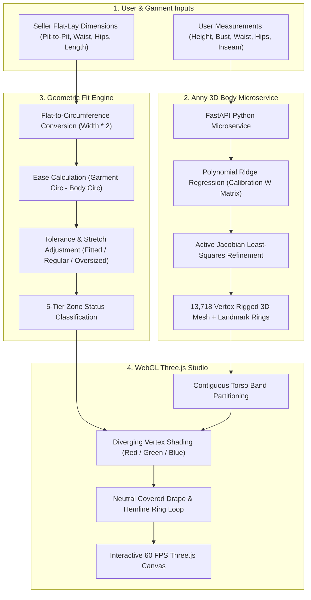

# Verdrobe · Technical Architecture & Pipeline

This document explains the mathematical and architectural pipeline powering Verdrobe, from raw user measurements to real-time 3D vertex coloring.

---

## 1. High-Level Architectural Pipeline



---

## 2. Core Mathematical Formulas

### A. Flat-Lay Garment to Circumference Conversion
Sellers measure garments lying flat on a table using a standard tape measure. To compare flat measurements against 3D body loops:

$$\text{Circumference} = \text{Flat-Lay Width} \times 2$$

- **Chest Circumference**: $\text{Pit-to-Pit Width} \times 2$
- **Waist Circumference**: $\text{Flat Waist Width} \times 2$
- **Hips Circumference**: $\text{Flat Hips Width} \times 2$
- **Length & Sleeve**: Measured straight along the seam without multiplication.

### B. Geometric Ease Calculation
Ease represents the breathing room between the garment and the skin:

$$\text{Ease} = \text{Garment Circumference} - \text{Body Circumference}$$

- **Positive Ease ($\text{Ease} > 0$)**: The garment is wider than the body (roomy/relaxed).
- **Zero Ease ($\text{Ease} = 0$)**: The garment matches the body circumference exactly.
- **Negative Ease ($\text{Ease} < 0$)**: The garment is smaller than the body (requires fabric stretch or creates tension).

### C. Tolerance & Fit Style Adjustment
Different garment styles and fabric stretch alter the expected target ease range:

| Garment Fit Style | Target Ease Range | Snug Threshold | Tight Threshold | Loose Threshold |
| :--- | :---: | :---: | :---: | :---: |
| **Fitted** | $+2\text{ to }+5\text{ cm}$ | $0\text{ to }+2\text{ cm}$ | $< 0\text{ cm}$ | $> +6\text{ cm}$ |
| **Regular** | $+4\text{ to }+10\text{ cm}$ | $+1\text{ to }+4\text{ cm}$ | $< +1\text{ cm}$ | $> +12\text{ cm}$ |
| **Oversized** | $+10\text{ to }+20\text{ cm}$ | $+5\text{ to }+10\text{ cm}$ | $< +5\text{ cm}$ | $> +24\text{ cm}$ |

### D. Fabric Stretch Compensation
If a garment contains elastane or knit stretch, allowable ease is expanded:
- **Low Stretch**: Adds $1.5\text{ cm}$ tolerance.
- **Medium Stretch**: Adds $3.5\text{ cm}$ tolerance.
- **High Stretch**: Adds $6.0\text{ cm}$ tolerance.

---

## 3. The 3D Body Microservice (Anny)

The body model is powered by **NAVER LABS Europe's Anny** parametric body library (Apache 2.0 License).

### Why Anny?
- Unlike SMPL, which is locked under restrictive non-commercial academic licensing, Anny is open-source and permissible for real product use.
- Rigged SMPL-compatible topology ($13,718\text{ vertices}$, $27,420\text{ triangles}$).
- Generates realistic adult morphology across continuous height, weight, muscle mass, and gender parameters.

### Two-Stage Fitting Process:
1. **Offline Precomputation & Polynomial Ridge Regression**:
   - A dataset of $3,000$ adult phenotype configurations was sampled and measured.
   - A polynomial feature mapping $\Phi(X)$ is fitted against Anny parameter vectors $Y$ using Ridge Regression:
   $$W = (\Phi^T \Phi + \lambda I)^{-1} \Phi^T Y$$
   - Achieves initial prediction within $\sim 0.357\text{ cm}$ median error in under $10\text{ ms}$.
2. **Online Active Jacobian Refinement**:
   - Precomputes the $6 \times 6$ sensitivity Jacobian matrix:
   $$J_{ij} = \frac{\partial \text{Measurement}_i}{\partial \text{Parameter}_j}$$
   - Runs $3$ fast Gauss-Newton iterations to adjust parameters until simulated mesh cross-sections match user inputs within sub-millimeter tolerances.

---

## 4. 3D Vertex Color Heatmap Generation

### Why a Skin Heatmap Instead of Cloth Simulation?
Simulating 3D garments (e.g. Marvelous Designer or Clo3D physics) presents three critical disadvantages for real-world marketplaces:
1. **Computational Heaviness**: Cloth collision solving takes $5\text{–}30\text{ seconds}$ per frame, destroying mobile web performance.
2. **Garment Geometry Scarcity**: Resellers cannot provide 3D CAD sewing patterns; they only provide photos and tape measurements.
3. **Misleading Artifacts**: Virtual cloth simulations often clip through meshes or introduce artificial creases that mislead buyers.

By projecting a **diverging fit heatmap onto the body skin**, Verdrobe renders at a steady **60 FPS in WebGL** on any modern phone or laptop, conveying instant sizing clarity.

### Contiguous Anatomical Band Partitioning:
The torso is divided into contiguous bands without artificial gaps:
1. **Shoulders Band**: Collarbone to upper chest midpoint.
2. **Chest Band**: Midpoint between shoulders and chest down to underbust.
3. **Waist Band**: Underbust down to iliac crest midpoint.
4. **Hips Band**: Iliac crest down to crotch landmark.

```
       [ Shoulders Band ]       -> Status Color (Flat 55% Opacity)
       ══════════════════       -> 1.5 cm Narrow Smooth Blend
       [  Chest Band    ]       -> Status Color
       ══════════════════       -> 1.5 cm Narrow Smooth Blend
       [  Waist Band    ]       -> Status Color
       ══════════════════       -> 1.5 cm Narrow Smooth Blend
       [   Hips Band    ]       -> Status Color
       ──────────────────       -> Crotch / Pelvis Landmark
       [ Covered Drape  ]       -> Neutral Calm Shading (#9A958D)
       ┈┈┈┈┈┈┈┈┈┈┈┈┈┈┈┈┈┈       -> Calibrated Dynamic Hemline Outline
       [ Uncovered Skin ]       -> Neutral Base Grey (#C5C0B7)
```

### Color Mapping Scale:
A single intuitive diverging scale with high contrast:
- **Too Tight**: Deep Red (`#D92D20`)
- **Snug**: Light Coral (`#FF6B5B`)
- **Balanced (True to Size)**: Emerald Green (`#0F6B2E` / `#B6FF3C`)
- **Relaxed**: Soft Sky Blue (`#4A90E2`)
- **Too Loose**: Deep Cobalt (`#1E3A8A`)
- **Covered Open Drape (Below Hips)**: Muted Taupe (`#9A958D`)
- **Uncovered Skin**: Neutral Alabaster Grey (`#C5C0B7`)
